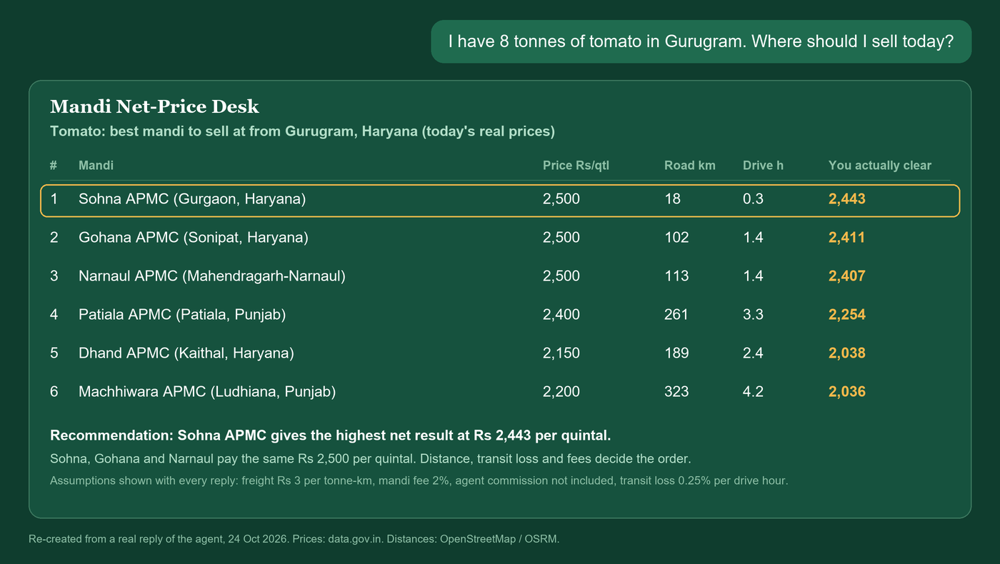
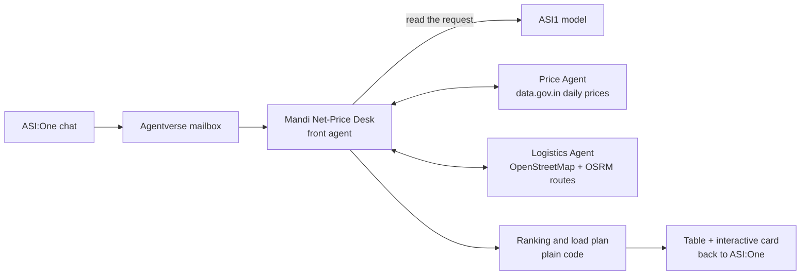

<div align="center">


### Which mandi should you sell at today? Ranked by what you actually clear, not the sticker price.


[**Try it**](#try-it-in-asione) &nbsp;|&nbsp; [Agents](#agents) &nbsp;|&nbsp; [How it works](#how-it-works) &nbsp;|&nbsp; [Real data](#real-data-and-what-is-an-assumption) &nbsp;|&nbsp; [Test](#test-it) &nbsp;|&nbsp; [Run](#run-it-yourself) &nbsp;|&nbsp; [Limits](#known-limits)

</div>

<br>

<table>
<tr>
<td width="33%" valign="top">

**The problem**

A trader in Gurugram can sell at dozens of mandis. The government publishes each price, but the highest price is rarely the best deal: you still pay for the drive, lose produce on the road and pay mandi fees.

</td>
<td width="33%" valign="top">

**What it does**

One sentence in ASI:One. The agent pulls today's real prices and real road distances, then ranks the mandis by **net rupees per quintal**. Buyers get landed cost.

</td>
<td width="33%" valign="top">

**What is different**

Three cooperating agents, live government data, plain-code maths you can test, assumptions printed in every reply, and fallbacks when a data source is down.

</td>
</tr>
</table>

Built at Fetch-A-Thon 3.0 (Fetch.ai Innovation Lab x Masters' Union Gurugram, 24 Oct 2026), the "ASI:One Agent Challenge: From Intent to Action". Team ID `fetchathon3.0-5865`.
**Team:** Laksh Pradhwani (lead), Mark Patel, Aryan Rao, Saiansh Kathuria.

## What an answer looks like

<div align="center">

</div>

Three mandis pay the same Rs 2,500 per quintal, yet they clear Rs 2,443, 2,411 and 2,407 because of distance. Net price = modal price minus transport minus transit loss minus mandi fees, per quintal. Buyer mode ranks by landed cost instead. Distances marked `~` are approximate (only the district centre could be located). Every reply lists the assumptions it used.

## Try it in ASI:One

Open the agent in ASI:One and ask in plain language:

- Profile: https://asi1.ai/ai/agent1qv7jdg7dyduuns3n4sp04gu5jkdhxv2s803p824h9c37ymw64mj7ufy86n4
- Handle: `@mandi-desk` (the address above always works; ASI:One may take a while to show the new name and handle)

> I have 25 tonnes of tomato in Gurugram. Where should I sell today?

> I run a restaurant in Delhi. Where is onion cheapest to buy today?

> [!NOTE]
> Replies take a while: ASI:One passes the message to the agent through the Agentverse mailbox (about 1 to 2 minutes), and the agent then pulls live data. The chat page may need a reload to show the reply. The agents must be running for this to work.

## Submission links

| Item | Link |
|---|---|
| Public GitHub repo | https://github.com/TheRealLaksh/fetchathon-3-agent |
| Agent in ASI:One | https://asi1.ai/ai/agent1qv7jdg7dyduuns3n4sp04gu5jkdhxv2s803p824h9c37ymw64mj7ufy86n4 |
| Public ASI:One shared chat | _to be added before submission_ |
| Demo video (3 to 5 min) | _to be added before submission_ |
| Write-up | [docs/writeup.md](docs/writeup.md) |
| Agentverse profiles | in the Agents table below |

## Agents

| Agent | Address | Agentverse profile | What it does |
|---|---|---|---|
| **Mandi Net-Price Desk** (front agent, `@mandi-desk`) | `agent1qv7jdg7dyduuns3n4sp04gu5jkdhxv2s803p824h9c37ymw64mj7ufy86n4` | [profile](https://agentverse.ai/agents/details/agent1qv7jdg7dyduuns3n4sp04gu5jkdhxv2s803p824h9c37ymw64mj7ufy86n4/profile) | Speaks the Agent Chat Protocol, reads the request with the ASI1 LLM, calls the two agents below, ranks the mandis, replies in chat with a table and an interactive card. |
| Mandi Price Agent | `agent1qdppp6kky9mlmq9j4c7v0nksqpvusy7w9vjxylzuu6xt48fs20mw7ecwcp0` | [profile](https://agentverse.ai/agents/details/agent1qdppp6kky9mlmq9j4c7v0nksqpvusy7w9vjxylzuu6xt48fs20mw7ecwcp0/profile) | Fetches today's real modal prices per mandi from the government daily mandi dataset (data.gov.in). Falls back to the last saved snapshot if the API is down. |
| Mandi Logistics Agent | `agent1qtw0yw8kanxv48wd0v2zrhdg4p6ewersauhstygfy4s2qv20fyxkjl8w9y3` | [profile](https://agentverse.ai/agents/details/agent1qtw0yw8kanxv48wd0v2zrhdg4p6ewersauhstygfy4s2qv20fyxkjl8w9y3/profile) | Locates each mandi (OpenStreetMap) and returns real road distance and drive time (OSRM). Estimates from straight-line distance if the routing service is down. |

The front agent is a mailbox agent (reachable from ASI:One). The two helper agents run as local agents registered on Agentverse (their profile pages show Active and Local) and are called by the front agent over HTTP. The three are separate uAgents that exchange typed messages (`mandi/models.py`), so this is a real multi-agent workflow, not one agent calling functions. All three carry the Innovation Lab and hackathon badges in their Agentverse READMEs (`docs/agent-readme-*.md`).

## How it works



Fetch.ai pieces used: uAgents, Agentverse mailbox agent, Agent Chat Protocol, ASI1 LLM, agent-to-agent messages, ASI:One interactive card.

## What the hackpack asks for, and where it is

| Requirement | Where |
|---|---|
| Register at least one agent on Agentverse | Three agents, each with an Agentverse profile (table above). The front agent is a mailbox agent. |
| Agent Chat Protocol | Front agent, `mandi/front_agent.py`. |
| Discoverable and usable in ASI:One | Open the profile link above in ASI:One, or mention the agent by address. Handle `@mandi-desk` is set on Agentverse. |
| Meaningful tool use or multi-agent orchestration | Live data APIs plus three cooperating agents that exchange typed messages. |
| Whole primary workflow inside ASI:One | Question, ranked answer and card all happen in the ASI:One chat. No custom frontend. |
| Public repo with run or test instructions | This README (Test it, Run it yourself). |

| Bonus item | Status |
|---|---|
| Multi-agent collaboration | Yes |
| Interactive Cards | A card is sent and renders in ASI:One (see Known limits for the button) |
| Reliability and error handling | Snapshot and route fallbacks, tested |
| Real-time data and external services | data.gov.in daily prices, OpenStreetMap, OSRM |
| Could keep running after the hackathon | Needs hosting (see What is next in the write-up) |
| Payment Protocol | Not implemented |

## Real data, and what is an assumption

| Real (live) | Assumption (shown in every reply, you can override in chat) |
|---|---|
| Mandi prices from data.gov.in, dated the day of the question | Freight Rs 3.0 per tonne-km |
| Mandi locations from OpenStreetMap | Market fee 2% |
| Road distance and drive time from OSRM | Agent commission 0% (not included) |
| | Transit loss 0.15 to 0.25% of value per drive hour |

For example, tell it "my truck costs Rs 4 per tonne-km" and it uses your number. Sources and how each assumption was derived are in [SOURCES.md](SOURCES.md). The top of the ranking did not change in our sensitivity tests, but the net figures move with these numbers.

## Test it

**No keys needed:** the maths, ranking, card format, load planner and both fallbacks are covered by offline tests.

```bash
pip install -r requirements.txt
python -m mandi.selftest      # prints nine "ok" lines and "9 tests passed"
```

**Live, in ASI:One:** use the link in "Try it in ASI:One" while the agents are running (they run on the team's laptop during judging).

## Run it yourself

<details>
<summary><b>Setup, keys, starting the agents, connecting the mailbox</b> (click to open)</summary>

<br>

Needs Python 3.10 to 3.13 (3.14 is not supported by uAgents yet).

```bash
python -m venv .venv
# Windows: .venv\Scripts\activate   macOS/Linux: source .venv/bin/activate
pip install -r requirements.txt
cp .env.example .env
```

Fill in `.env` (never commit it):

| Variable | What it is | Where to get it |
|---|---|---|
| `ASI1_API_KEY` | ASI1 model access | https://asi1.ai/platform/developer |
| `AGENTVERSE_API_KEY` | connects the mailbox | https://agentverse.ai/profile/api-keys |
| `DATA_GOV_IN_API_KEY` | mandi prices | free: sign up at https://www.data.gov.in, open the dataset "Current Daily Price of Various Commodities from Various Markets (Mandi)", API tab, Generate API Key |
| `AGENT_SEED_PHRASE` | one long random string | make one up; the front agent derives the helper agents' addresses from it, so use the same value in all three processes. A new seed gives new addresses. |

Start three processes, each in its own terminal, the front agent last:

```bash
python -m mandi.price_agent
python -m mandi.logistics_agent
USE_MAILBOX=1 python -m mandi.front_agent
```

**Connect the mailbox** (once): open the Agent Inspector link the front agent prints while signed in to Agentverse, click Connect, then Mailbox. If the page cannot reach `localhost` (a browser setting can block it), connect from a terminal instead:

```bash
curl -X POST http://127.0.0.1:8001/connect -H "Content-Type: application/json" -d '{"user_token": "<AGENTVERSE_API_KEY>", "agent_type": "mailbox"}'
```

Then open the front agent in ASI:One and ask a question.

Local test without ASI:One: `python -m mandi.chat_test "I have 8 tonnes of tomato in Gurugram. Where should I sell today?"`

Pre-load the map cache so the first question about a crop or town is fast (run while no question is being answered): `python -m mandi.warm_cache Tomato Onion Potato -- "Gurugram, Haryana" "Delhi, NCT of Delhi"`

</details>

## Known limits

> [!WARNING]
> Please read these before judging the live demo.

- The agents run on a laptop; the mailbox agent only answers while all three processes are running.
- First question for a crop or town not yet cached can take minutes (the free map lookup allows one request per second).
- The government dataset holds only today's prices, so there is no trend or "wait and sell later" advice.
- Agent commission is not included unless the user states it. Freight is derived from long-haul rates; short hauls usually cost more per tonne-km.
- The interactive card renders in ASI:One. The "Plan this load" button flow was verified locally and in unit tests but not confirmed end to end inside ASI:One; typing "plan the load for <mandi>" is also handled.
- Some mandis could only be located by district, so their distance is approximate and marked `~`.

## Repository

<details>
<summary><b>File map</b> (click to open)</summary>

```
mandi/core.py            data calls, net-price maths, snapshots, fallbacks
mandi/models.py          messages between the agents
mandi/price_agent.py     Price Agent
mandi/logistics_agent.py Logistics Agent
mandi/front_agent.py     ASI:One-facing agent
mandi/ranking.py         ranking and reply text
mandi/extras.py          interactive card and load planner
mandi/branding.py        Agentverse profile details for each agent
mandi/selftest.py        offline tests
SOURCES.md               sources for the assumptions
docs/                    write-up, video script, submission checklist, agent READMEs
assets/                  profile picture, banner, example image
```

</details>

## Extra resources

- ASI:One API key: https://asi1.ai/platform/developer
- Agentverse API key: https://agentverse.ai/profile/api-keys
- Mandi price dataset (data.gov.in): https://www.data.gov.in/resource/current-daily-price-various-commodities-various-markets-mandi
- Place lookup: OpenStreetMap Nominatim, https://nominatim.openstreetmap.org (usage policy: one request per second, which the agent respects)
- Road routes: OSRM public demo server, https://router.project-osrm.org
- Fetch.ai docs: https://innovationlab.fetch.ai/resources/docs/intro
- Interactive Cards docs: https://innovationlab.fetch.ai/resources/docs/interactive-cards/asi-interactive-cards

<div align="center">

<br>


**Mandi Net-Price Desk** &nbsp;|&nbsp; Fetch-A-Thon 3.0 &nbsp;|&nbsp; Team `fetchathon3.0-5865`

</div>
